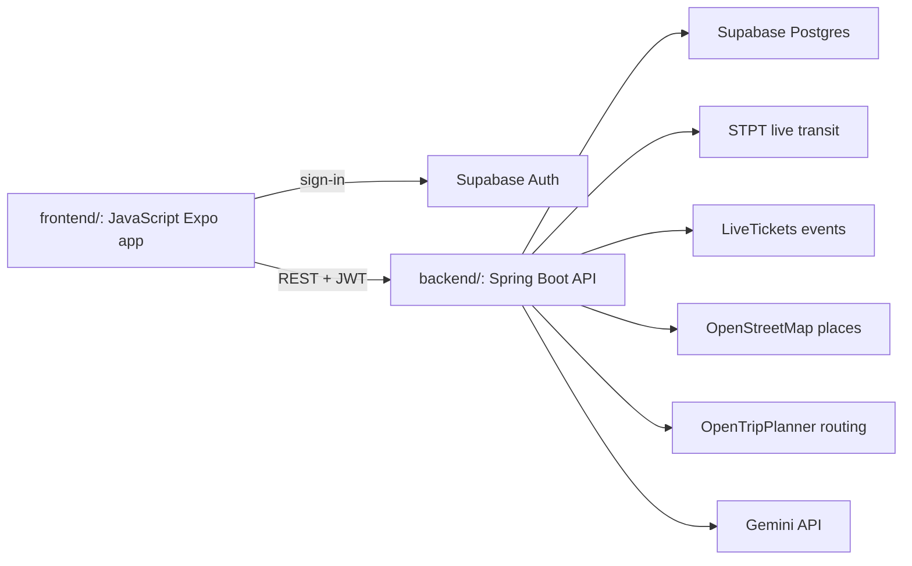

# DOCS

Project documentation. One section per feature — edit only the section you own (see `PLAN.md`).

## Overview

Mobile app for Timișoara: events (imported and user-created) with QR check-in and reliability points, a filterable map of places, live public transport, directions, and an AI guide.

- **Plan and task list:** `PLAN.md`
- **Rules for contributors and agents:** `AGENTS.md`
- **API contract:** `docs/API.md` (created in PLAN task 1.6)

## Architecture

```
Expo Go app ──(Supabase Auth: sign-in only)──> Supabase
     │
     └──(REST + Supabase JWT)──> Spring Boot API ──> Supabase Postgres
                                      ├──> live.stpt.ro      (live transit, cached)
                                      ├──> LiveTickets       (events import job)
                                      ├──> Nominatim         (venue name -> coordinates)
                                      ├──> OpenTripPlanner 2 (routing)
                                      └──> Gemini API        (chat with tools + web lookup)
```

The mobile app never calls third-party data sources directly; the backend proxies and caches them.

## Configuration and running

- **Backend keys:** `backend/src/main/resources/application-local.properties` (git-ignored). Never commit real values.
- **Mobile keys:** `frontend/.env` (git-ignored) — Supabase URL, Supabase publishable key, backend address only. Add the variable names to the existing `frontend/.env.example`.
- **No deployment:** the backend runs on a laptop and the app runs in Expo Go on phones on the same Wi-Fi.
- **No seed data:** accounts are created in the app; events come from the LiveTickets import and the create-event form.
- **Merging:** branches go into `main` only when Stefan says so.

## Current state

- `backend/`: Spring Boot 4.1.2 API with the users/profile endpoints and JWT resource-server configuration. The remaining features are not implemented.
- `frontend/`: existing Expo SDK 54 app written in JavaScript (`.js`/`.jsx`), with Expo Router, a map screen, location support, and an API helper. The planned tabs and feature screens are not built yet.
- `docs/API.md`: users/profile contract added; contracts for the other features are pending. `infra/` and `supabase/` are not created yet.
- Supabase project and schema: Stefan is creating them; not verified in this checkout.

## External data sources

Checked on 2026-11-13 by calling each endpoint. None of these is a documented public API — they are what the sites' own pages call. Always go through the backend, cache, and keep request volume low.

### STPT live transit — `https://live.stpt.ro`

| Endpoint | Returns |
|---|---|
| `/gtfs-vehicles.php?route=<line>` | Live vehicles of a line: `id`, `lat`, `lng`, `bearing`, `speed`, `route`, `directionId`, `headsign`, next `stop`, `timestamp`, `tripId` |
| `/gtfs-data/stops-index.json` | All stops: `stop_code`, `stop_name`, `lat`, `lon`, `routes[]` |
| `/gtfs-data/route-manifest.json` | Route list plus GTFS feed info (source file `smtt-timisoara-ro.zip`, feed version, service date range) |
| `/routes/capeti-linie.json` | End stations of each line (`tur` / `retur`) |
| `/proxy-smtt-cache.php?stopid=<id>` | Arrivals at a stop (seen in the site's script; response not sampled yet) |
| `/proxy-alerts.php` | Service alerts: `id`, `headerText`, `descriptionText` |
| `/api/journey.php?…` | The site's own journey planner (seen in the script; parameters not explored) |

The GTFS zip itself was not found at an obvious URL on the site — see PLAN open question 2.

### LiveTickets events — `https://api.livetickets.ro`

| Endpoint | Returns |
|---|---|
| `/public/events-home-v2?a=1` | Array of events: `event_id`, `url`, `name`, `description` (HTML), `location` (venue name), `city`, `start_date`, `end_date`, `price_min`, `price_max`, `image` |
| `/public/events` | Event search (seen in the site's script; query parameters not explored) |
| `/public/events/getbyid?id=<id>` | One event (seen in the site's script) |

Events carry a venue name and city but **no coordinates** — they are geocoded with Nominatim (PLAN task 7.3).

### OpenStreetMap

- **Places:** Overpass API, imported once into the `places` table (PLAN task 8). Counted for the Timișoara area on 2026-11-13: 239 restaurants, 121 cafés, 89 bars/pubs, 134 fast-food places, 123 pharmacies. Only 82 of the 239 restaurants have opening hours. Freshness of the 583 food and drink places: 125 last edited in 2026, 296 since January 2025, 401 since January 2023; 182 untouched since before 2023, so some of those may have closed or changed.
- **Geocoding:** Nominatim, max 1 request/second, only for newly imported events; the coordinates are saved on the event row.
- **Streets for routing:** `.osm.pbf` extract of Timișoara for OpenTripPlanner 2 (PLAN task 10).
- OSM has no prices, menus or reviews — the AI looks those up on the web (Gemini, below).

### Gemini API (AI assistant)

Checked against Google's documentation on 2026-11-13.

- **Chat:** a free-tier Gemini model with function calling; it calls our own tools (places, events, transit, routes) — PLAN task 11.2.
- **Web lookup:** a separate Gemini request with Google Search switched on, used for prices, menus and reviews — PLAN task 11.3. Kept separate because only the Gemini 3 and 4 models can mix Google Search with our own tools in one request.
- **Free-tier limit on web search:** free only on `gemini-2.5-flash` / `gemini-2.5-flash-lite` (500 requests per day); both are redirected to newer models on 1 December 2026. On the newer free models it is listed as not available; on a paid account 5,000 searches per month are free. The hackathon ends on 15 November 2026, before that date, so the web lookup uses `gemini-2.5-flash` for free. The price page was long and only partly read — test one web lookup early to confirm.
- **Why not Google Maps data directly:** Google's terms forbid scraping or bulk-downloading its places and saving their names, addresses and reviews, and its Places API has no menu or dish-price data.

## Features

### Users and profiles (PLAN 4)

- `GET /users/me` and `GET /users/{id}` return a profile with username, reliability score, creation time, and confirmed attended events. `GET /users/search?q=` returns up to 20 username-prefix matches. `PATCH /users/me` changes a username matching `[A-Za-z0-9_]{3,20}` and returns `409 USERNAME_TAKEN` on conflict.
- All `/users/**` requests require a Supabase JWT. Spring Security validates the signature through the project JWKS URL and the issuer through the Supabase URL. Only event list/detail, place list/detail, and transit GET endpoints are public; event tickets remain protected. The JWT `sub` is the profile UUID. Stefan's Supabase project must use asymmetric JWT signing keys for JWKS validation and enforce case-insensitive uniqueness of `profiles.username` in the database.
- The API assumes `profiles(id, username, reliability_score, created_at)`, `event_participants(event_id, user_id, status)`, and `events(id, title, starts_at)`, as specified in PLAN 2. The attended-events query selects only `ATTENDED` rows. These tables and the auth-user profile trigger are being created separately; live integration is pending.
- Endpoint examples and current error codes are in `docs/API.md`. The remaining feature contracts are still pending under PLAN 1.6.
- Local secrets go in ignored `backend/src/main/resources/application-local.properties`; copy the names from the committed `.example` file. Run `cd backend` then `.\gradlew.bat bootRun` on Windows. For a phone in Expo Go, use the laptop's LAN IP in `frontend/.env` as `EXPO_PUBLIC_API_URL=http://<laptop-ip>:8080`; both devices must be on the same Wi-Fi. The API needs the Supabase database and JWKS settings to serve real requests.
- Tests use Mockito and an in-memory H2 database; no test connects to Supabase. Run `cd backend` then `.\gradlew.bat test`.

Other feature sections are added as PLAN tasks are implemented: Events, Reliability, Places, Transit, Routing, AI, Mobile.

## Knowledge graph

Current project and planned integration paths (PLAN task 1.8 will expand this as features are implemented):


